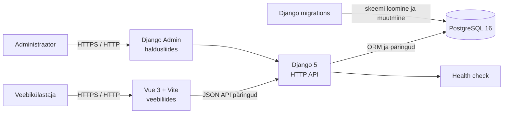

# KinoProjekti tarkvaranõuete spetsifikatsioon (SRS)

## 1. Dokumendi ülevaade

| Väli | Väärtus |
| --- | --- |
| Projekt | TA-24A-3 kinoprojekt |
| Dokument | Tarkvaranõuete spetsifikatsioon (Software Requirements Specification) |
| Versioon | 0.1 |
| Staatus | Esialgne |
| Kuupäev | 2026-10-29 |
| Tehniline alus | Vue 3, Vite, Django 5, PostgreSQL 16 |

Dokument kirjeldab kinopiletite ja kinoinfo veebirakenduse eesmärki, põhinõudeid,
esialgset arhitektuuri ning kontrollitavaid kvaliteedinõudeid. Nõuded on
koostatud projekti praeguse lähtekoodi, andmemudeli ja arendusplaani põhjal.

Nõude olekud:

- **Olemas** – nõue on projekti praeguses versioonis vähemalt osaliselt
  realiseeritud.
- **Kavandatud** – nõue kuulub sihtfunktsionaalsusse, kuid ei ole veel
  täielikult realiseeritud.

## 2. Eesmärk ja ulatus

Rakenduse eesmärk on võimaldada kasutajal tutvuda filmide, žanrite, kinode,
kinosaalide ja seanssidega ning tulevikus valida seanss, broneerida istekohad
ja tasuda piletite eest. Administraator peab saama hallata rakenduse
põhiandmeid turvalise haldusliidese kaudu.

Projekti ulatusse kuuluvad:

- filmide, žanrite, kinode, saalide, istekohtade ja seansside kataloog;
- kasutajakonto ja autentimine;
- seansi ning vabade kohtade põhine broneerimine;
- makse oleku talletamine;
- kasutaja arvustused ja hinnangud;
- responsiivne Vue-põhine veebiliides;
- Django HTTP API ja PostgreSQL-andmebaas.

Projektist jäävad esialgu välja päris makseteenuse integratsioon, kinopiletite
printimine ning mitme organisatsiooni või kinoketi eraldi haldus.

## 3. Osapooled ja kasutajarollid

| Roll | Vajadus |
| --- | --- |
| Külastaja | Vaadata filme, žanreid, kinosid ja seansse ilma kontota. |
| Registreeritud kasutaja | Hallata oma kontot, teha broneeringuid, vaadata broneeringuid ja lisada arvustusi. |
| Administraator | Hallata filme, žanreid, kinosid, saale, istekohti, seansse ja kasutajaandmeid. |
| Arendaja | Käivitada, testida ja edasi arendada süsteemi Docker Compose'i keskkonnas. |

## 4. Funktsionaalsed nõuded

### 4.1 Avalik kataloog

| ID | Nõue | Olek |
| --- | --- | --- |
| FR-01 | Süsteem peab kuvama tulevaste seanssidega filmide loendi. | Olemas |
| FR-02 | Süsteem peab kuvama filmi detailandmeid: pealkiri, kirjeldus, pikkus, väljalaske kuupäev, vanusepiirang, keel, plakat ja treiler, kui need on olemas. | Olemas |
| FR-03 | Kasutaja peab saama filtreerida filme vähemalt žanri ja seansi tüübi järgi. | Olemas |
| FR-04 | Süsteem peab kuvama kinode ja nende saalide andmeid. | Olemas |
| FR-05 | Süsteem peab kuvama seansi filmi, kino, saali, algus- ja lõppaega, keelt, subtiitreid ning baashinda. | Olemas |
| FR-06 | Kataloogi API peab toetama loendi- ja detailpäringuid ning tundmatu ID korral tagastama HTTP 404. | Olemas |
| FR-07 | Kataloogi lugemis-API peab lubama GET- ja HEAD-päringuid ning keelama rakendamata kirjutamismeetodid HTTP 405 vastusega. | Olemas |

### 4.2 Kasutajad ja autentimine

| ID | Nõue | Olek |
| --- | --- | --- |
| FR-08 | Kasutaja peab saama luua konto, logida sisse ja logida välja. | Kavandatud |
| FR-09 | Süsteem peab hoidma kasutaja nime, kontaktandmeid ja parooli ainult turvaliselt räsitud kujul. | Kavandatud |
| FR-10 | Kasutaja peab saama vaadata ja muuta oma profiiliandmeid. | Kavandatud |
| FR-11 | Süsteem peab kontrollima autentimist ja kasutaja õigusi enne isiku-, broneeringu- või makseandmete tagastamist. | Kavandatud |

### 4.3 Broneerimine ja maksed

| ID | Nõue | Olek |
| --- | --- | --- |
| FR-12 | Autenditud kasutaja peab saama valida seansi ja ühe või mitu vaba istekohta. | Kavandatud |
| FR-13 | Süsteem peab takistama sama istekoha broneerimist samale seansile rohkem kui üks kord. | Andmemudel olemas; töövoog kavandatud |
| FR-14 | Süsteem peab arvutama broneeringu kogusumma valitud kohtade ja hindade põhjal. | Kavandatud |
| FR-15 | Süsteem peab looma broneeringu olekuga ning seostama selle kasutaja, seansi ja broneeritud kohtadega. | Kavandatud |
| FR-16 | Süsteem peab talletama makse summa, meetodi, oleku, viite ja maksmise aja. | Andmemudel olemas; integratsioon kavandatud |
| FR-17 | Kasutaja peab saama vaadata oma aktiivseid ja varasemaid broneeringuid. | Kavandatud |

### 4.4 Arvustused ja haldus

| ID | Nõue | Olek |
| --- | --- | --- |
| FR-18 | Autenditud kasutaja peab saama filmile lisada hinnangu vahemikus 1–5 ja soovi korral kommentaari. | Andmemudel olemas; API kavandatud |
| FR-19 | Administraator peab saama hallata kataloogiandmeid ja seansse. | Kavandatud |
| FR-20 | Administraatori funktsioonid peavad olema tavakasutaja eest kaitstud. | Kavandatud |
| FR-21 | Süsteem peab pakkuma tervisekontrolli otspunkti, mis kinnitab rakenduse kättesaadavust. | Olemas |

## 5. Mittefunktsionaalsed nõuded

| ID | Nõue |
| --- | --- |
| NFR-01 | Rakendus peab töötama Docker Compose'i abil eraldi frontend-, backend- ja andmebaasiteenusena. |
| NFR-02 | Frontend peab olema kasutatav tänapäevases lauaarvuti- ja mobiilibrauseris ning kohanduma eri ekraanisuurustega. |
| NFR-03 | Backend peab kasutama Django migratsioone andmebaasiskeemi ainsa haldusmehhanismina. |
| NFR-04 | API peab tagastama järjepideva JSON-kuju ja sobivad HTTP olekukoodid. |
| NFR-05 | Tootmiskeskkonnas ei tohi kasutada vaikimisi salasõnu ega arenduse salavõtit; konfiguratsioon peab pärinema keskkonnamuutujatest. |
| NFR-06 | Andmete terviklikkus peab olema tagatud võõrvõtmete, unikaalsuspiirangute ja valideerimisega. |
| NFR-07 | Süsteem peab logima serveripoolsed vead nii, et kasutajale ei avaldata tundlikke tehnilisi üksikasju. |
| NFR-08 | Iga uue kasutusjuhu ja kriitilise ärireegli juurde tuleb lisada automaattestid. |

## 6. Andmenõuded

Süsteem peab toetama vähemalt järgmisi põhiobjekte:

- **User** – kasutaja ja tema kontaktandmed;
- **Cinema**, **CinemaHall**, **Seat** – kino, saal ja istekoht;
- **Movie**, **Genre**, **MovieGenre** – film, žanr ja nende seos;
- **Screening** – filmi seanss konkreetses saalis;
- **Booking**, **BookedSeat** – broneering ja selle kohad;
- **Payment** – broneeringuga seotud makse;
- **Review** – kasutaja hinnang ja kommentaar filmile.

Olulised ärireeglid:

1. ühe saali rea ja numbri kombinatsioon on kordumatu;
2. sama film-žanr seos võib esineda ainult üks kord;
3. seansi lõppaeg peab olema algusajast hilisem;
4. sama istekoht võib sama seansi jooksul kuuluda ainult ühele broneeringule;
5. arvustuse hinnang peab jääma vahemikku 1–5;
6. kustutamine ei tohi rikkuda seotud tehingu- ega kataloogiandmete terviklikkust.

## 7. Süsteemi esialgne arhitektuur

Rakendus kasutab kihilist klient-server-arhitektuuri. Vue frontend suhtleb
Django API-ga HTTP kaudu ning Django kasutab püsivate andmete jaoks
PostgreSQL-i. Administraatori haldusliides asub Django rakenduse juures.

### 7.1 Komponendid

| Komponent | Vastutus |
| --- | --- |
| Vue frontend | Vaated, navigatsioon, filtrid, vormid ja kasutaja tagasiside. |
| Django backend | Äriloogika, õiguste kontroll, valideerimine ja JSON API. |
| Django Admin | Kataloogi- ja haldusandmete administraatoripoolne haldus. |
| PostgreSQL | Kasutajate, kataloogi, broneeringute, maksete ja arvustuste püsiv salvestus. |
| Django migrations | Versioonitud ja korratav andmebaasiskeemi haldus. |

### 7.2 Peamised liidesed

Olemasolevad avalikud liidesed:

- `GET /api/cinema/` – tervisekontroll;
- `GET /api/cinema/movies/` ja `GET /api/cinema/movies/<id>/`;
- `GET /api/cinema/cinemas/` ja `GET /api/cinema/cinemas/<id>/`;
- `GET /api/cinema/halls/` ja `GET /api/cinema/halls/<id>/`;
- `GET /api/cinema/screenings/` ja `GET /api/cinema/screenings/<id>/`;
- `/admin/` – Django haldusliidese URL.

Autentimise, broneerimise, maksete ja arvustuste kirjutamis-API tuleb
realiseerida järgmises arendusetapis.

## 8. Põhilised kasutuslood

### UC-01: Filmide otsimine

1. Külastaja avab filmide vaate.
2. Süsteem laadib filmide kataloogi API-st.
3. Külastaja valib žanri või seansi tüübi filtri.
4. Süsteem kuvab filtrile vastavad filmid.

### UC-02: Seansi valimine ja broneerimine

1. Kasutaja logib sisse.
2. Kasutaja valib filmi, kino, seansi ja vabad istekohad.
3. Süsteem kontrollib kohtade saadavust ja arvutab kogusumma.
4. Kasutaja kinnitab broneeringu ning valib makseviisi.
5. Süsteem salvestab broneeringu ja makse oleku ning kuvab kinnituse.

### UC-03: Kataloogi haldamine

1. Administraator logib Django Admini sisse.
2. Administraator lisab või muudab filmi, kino, saali või seansi andmeid.
3. Süsteem valideerib sisendi ja salvestab muudatuse.
4. Muudetud andmed muutuvad avalikus kataloogis nähtavaks.

## 9. Vastuvõtukriteeriumid

Esialgne versioon loetakse nõuetele vastavaks, kui:

- frontend, backend ja PostgreSQL käivituvad dokumenteeritud Docker Compose'i
  käskudega;
- tervisekontroll ja kataloogi lugemis-API-d vastavad dokumenteeritud kujul;
- filmide vaade kuvab API andmeid ning filtrid töötavad;
- andmebaasi migratsioonid rakenduvad puhtale andmebaasile;
- broneerimise ja autentimise realiseerimisel kontrollitakse kohtade
  topeltbroneerimise vältimist automaattestidega;
- tootmisseadistuses ei ole arenduse vaikeparoolid ega salavõti kasutusel.

## 10. Seos tehnilise dokumentatsiooniga

Rakenduse käivitamise, olemasolevate otspunktide, andmemudeli tehnilise
kirjelduse ja arendusjärjekorra kohta vaata
[`documentation.md`](documentation.md). Käesolev SRS kirjeldab eelkõige
*mida* süsteem peab tegema; tehniline dokumentatsioon kirjeldab, *kuidas*
praegune lahendus on üles ehitatud.
